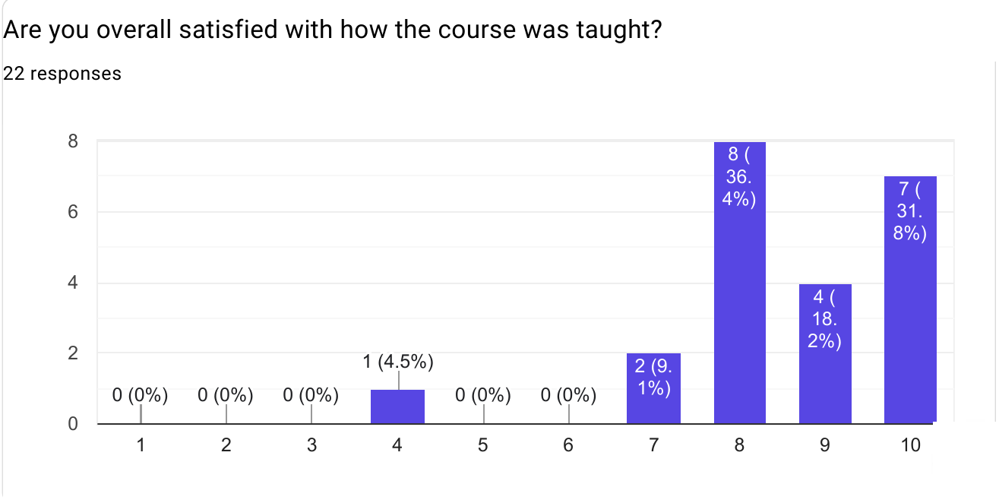
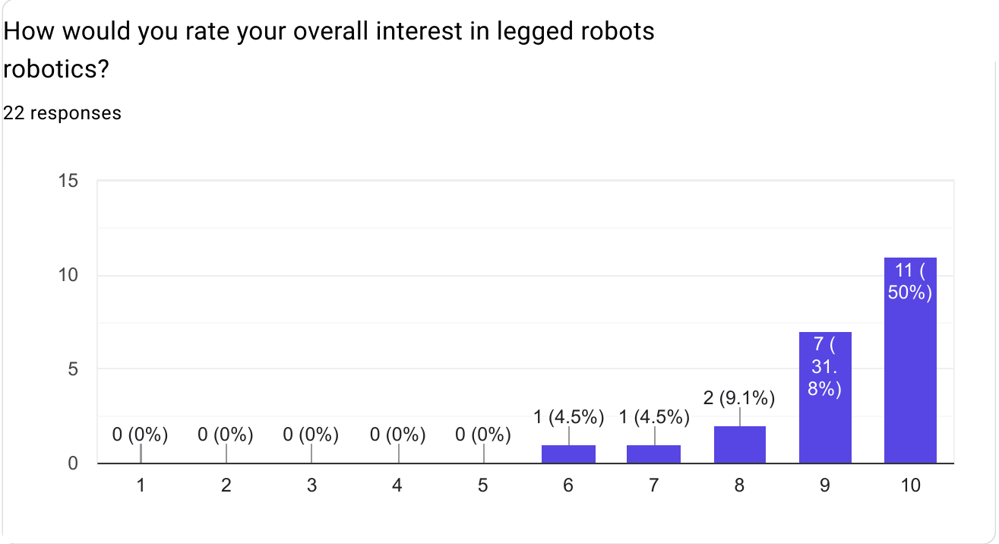
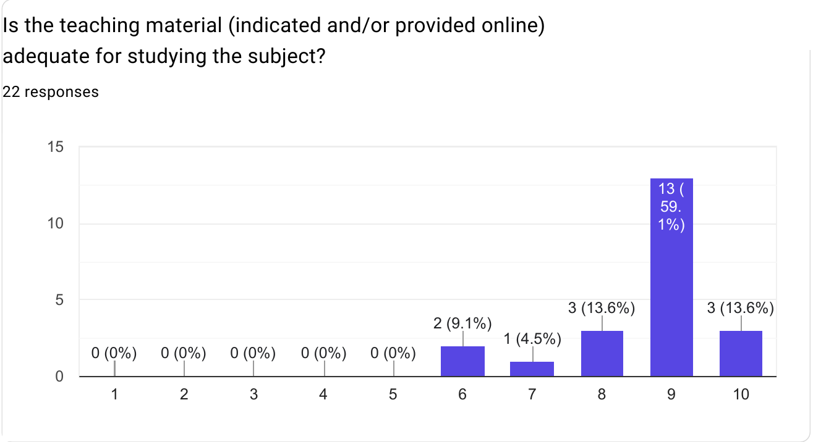
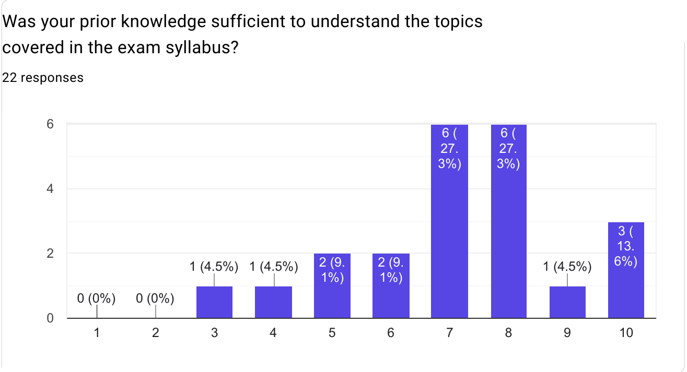
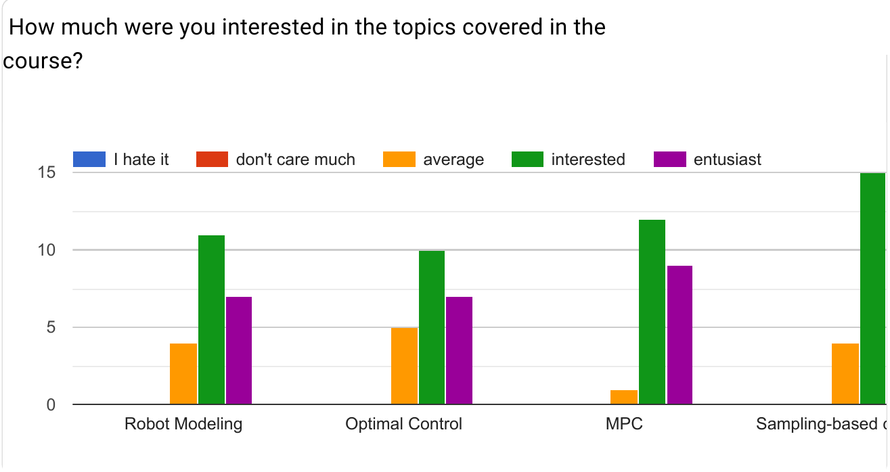
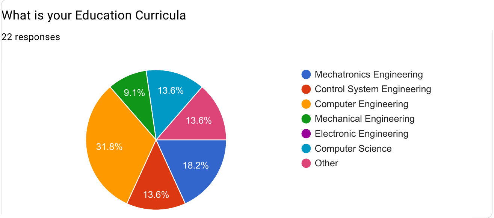

# 🦿 WHERE: Walk the Future

### International Euregio Summer School on Legged Robots

Official GitHub page of the **WHERE** summer school: lectures, slides, practical sessions and material on modeling, optimal control, MPC and sampling-based control for legged robots.

 

  

---

## 📺 Lecture recordings

All lectures were recorded and are available as a YouTube playlist:

👉 **[WHERE Summer School – full playlist](https://www.youtube.com/playlist?list=PLWLGtszvv1MA)**

## 📂 Repository content

| Resource | Description |
|---|---|
| [`Course_timetable_WHERE.pdf`](Course_timetable_WHERE.pdf) | Daily timetable of lectures and labs |
| [`detailed_program.pdf`](detailed_program.pdf) | Detailed program of the school |
| [`slides/`](slides) | Slides of the lectures |
| [`practical_sessions/`](practical_sessions) | Material and code for the hands-on sessions |
| [`bios/`](bios) | Speaker biographies |
| [`catering_menu.pdf`](catering_menu.pdf) | Catering menu |

---

## 📊 Participant feedback

At the end of the school we collected an anonymous feedback form (**22 responses**). Full results: [`feedback/Feedback_form_WHERE_summer_school_on_legged_robots.pdf`](feedback/Feedback_form_WHERE_summer_school_on_legged_robots.pdf)

### At a glance (average score, 1–10)

| Question | Average | Score ≥ 8 |
|---|:---:|:---:|
| 🦿 Overall interest in legged robotics | **9.2** | 91% |
| 📚 Teaching material adequate for studying the subject | **8.6** | 86% |
| ⭐ Overall satisfaction with how the course was taught | **8.5** | 86% |
| 🧠 Prior knowledge sufficient for the syllabus | **7.2** | 55% |

### Charts

<table>
  <tr>
    <td width="50%"></td>
    <td width="50%"></td>
  </tr>
  <tr>
    <td width="50%"></td>
    <td width="50%"></td>
  </tr>
  <tr>
    <td width="50%"></td>
    <td width="50%"></td>
  </tr>
</table>

### Interest in the individual topics

| Topic | Average | Interested | Enthusiast |
|---|:---:|:---:|:---:|
| Robot Modeling | 4 | 11 | 7 |
| Optimal Control | 5 | 10 | 7 |
| Model Predictive Control (MPC) | 1 | 12 | **9** |
| Sampling-based Control | 4 | **15** | 3 |

No participant rated any topic as *"don't care much"* or *"I hate it"*.

**Takeaway:** participants were highly motivated (half gave 10/10 interest in legged robotics) and very satisfied with the course and its material. Prior knowledge was the most spread-out score, suggesting that a short preparatory module (e.g. refresher on rigid-body dynamics and optimization) could help future editions.

---

Organized by the [IDRA Lab](https://github.com/idra-lab) · ⭐ Star the repo if you found the material useful!

